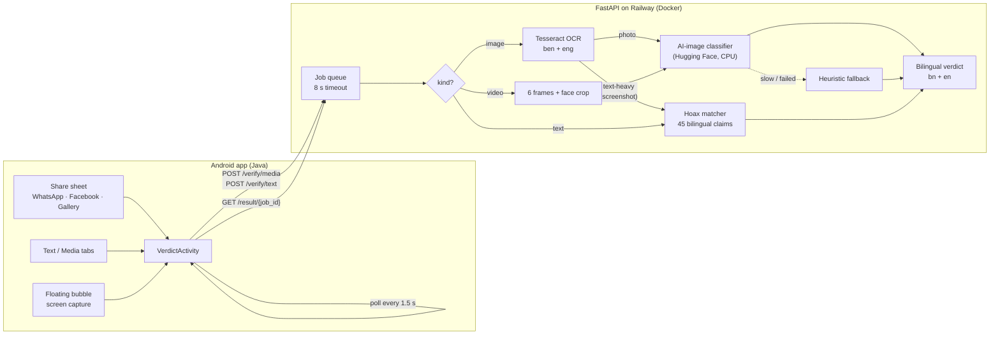

<div align="center">


# Jachai

**যাচাই · Check it before you forward it.**

An Android app that tells you, in plain Bengali and English, whether a message, photo or video looks fake, AI-made or like a known hoax. Built for the people who receive the most forwarded rumours, and for the family members who look out for them.

[Quick start](#quick-start) · [What it does](#what-it-does) · [Design](#design) · [Backend](#backend) · [Android](#android) · [Roadmap](#roadmap)

</div>

---

## Quick start

1. **Install:** copy `app-release.apk` to an Android phone (Android 7.0 or newer), open it and tap **Install**. Allow installs from that source if asked.
2. **Set up the backend:** use the hosted server `https://jachai-api-production.up.railway.app/`, or run your own with `docker run -p 8000:8000 jachai-api` and check that `http://localhost:8000/health` returns `"status":"ok"`.
3. **Set the URL:** in Jachai, open **Settings → Server**, paste the address (keep the trailing `/`) and tap **Save & test**. The status light turns green when connected.

## What it does

| | |
|---|---|
| **Check a text** | Paste a message, news item or post into a large text box and tap **Check**. |
| **Photos and videos** | Choose from the gallery; Jachai looks for signs of AI generation and reads the text in screenshots. |
| **Share sheet** | In WhatsApp, Facebook or the gallery, tap **Share → Jachai** to check a post directly. |
| **Floating bubble** | Turn it on, use the phone as usual, and tap the bubble when something looks suspicious. Jachai checks what's on screen. |
| **Clear verdicts** | A full-width red or green result with a plain-words certainty ("Very sure"), what to do next, and why. A double buzz when something is fake. |
| **Made for older eyes** | Large text by default (Small, Medium, Large), big touch targets, light and dark mode, Bengali and English. |
| **Your activity** | Checks done, fakes caught and a 7-day chart, counted on the phone only. |

## Design

The identity is black and white with one soft accent. The icon is a **j** whose dot floats outside the tile, in a bite taken from its corner, the way Jachai's bubble floats over other apps. Inside the app the **j**'s dot becomes a speech bubble.

<table>
  <tr>
    <td align="center" width="25%"><br><sub><b>App icon</b><br>512 px, light</sub></td>
    <td align="center" width="25%"><br><sub><b>App icon</b><br>dark surfaces</sub></td>
    <td align="center" width="25%"><br><sub><b>In-app mark</b><br>speech-dot j</sub></td>
    <td align="center" width="25%"><br><sub><b>Small-size cut</b><br>redrawn for 16 px</sub></td>
  </tr>
</table>

| Token | Light | Dark | Use |
|---|---|---|---|
| `--primary` | `#111111` | `#F5F5F4` | Tile, mark, headlines |
| `--secondary` | `#F2F2F0` | `#1C1C1E` | Cards, header canvas |
| `--bg` | `#FFFFFF` | `#0E0E0F` | Page |
| `--accent` | `#8CA8F9` | `#8CA8F9` | The floating dot only |

Verdict colours stay fixed in both modes: fake `#C62828`, real `#2E7D32`, unsure `#455A64`.

All assets (icons, adaptive icon, banners, header background) are generated by [`design/build_kit.py`](design/build_kit.py) into [`design/app-kit/`](design/app-kit/); usage rules are in its [README](design/app-kit/README.md).

## How it works



```
android/   Native Java app (min SDK 24): tabs, verdict screen, share-sheet entry, floating bubble
backend/   FastAPI service: /verify/media, /verify/text, /result/{job_id}, /health
design/    App UI asset kit: icons, marks, banners, header background, colour tokens
docs/      API_CONTRACT.md, DEMO.md (stage runbook)
```

## Backend

```powershell
cd backend
python -m venv .venv
.venv\Scripts\pip install -r requirements-dev.txt
# real model (otherwise heuristics):
.venv\Scripts\pip install torch --index-url https://download.pytorch.org/whl/cpu
.venv\Scripts\pip install -r requirements-ml.txt

.venv\Scripts\python -m pytest -q                              # 34 tests
.venv\Scripts\uvicorn app.main:app --host 0.0.0.0 --port 8000
```

Or with Docker, which bundles Tesseract with Bengali and the model:

```powershell
cd backend
docker build -t jachai-api .
docker run -p 8000:8000 jachai-api
```

| Script | Use |
|---|---|
| `scripts/compare_models.py ../samples` | Compare candidate detectors on `samples/real` + `samples/fake` |
| `scripts/calibrate.py ../samples --url <server>` | Score samples against a running server, suggest `FAKE_THRESHOLD` |
| `scripts/benchmark_model.py` | Model load time + CPU latency |
| `scripts/add_override.py <file> red\|green [--hoax-id ID]` | Pin a rehearsed demo file's verdict (by SHA-256) |
| `scripts/prewarm.py [--image FILE]` | Wake the server and exercise each path before going on stage |

Settings are environment variables; see `backend/.env.example`. The important ones:

- `ENABLE_ML=false` uses the heuristic scorer only, which is cheap on memory.
- `MOCK_MODE=true` returns fixed alternating red/green answers for UI work.
- `FAKE_THRESHOLD` and `HOAX_THRESHOLD` are the verdict cut-offs.

**Deploy on Railway:** GitHub repo → *Deploy from repo* → Root Directory `backend` → *Generate Domain*. Keep *Serverless* off so the in-memory job store isn't wiped. With `ENABLE_ML=true` the service needs about 1–1.5 GB RAM. Point an UptimeRobot HTTP monitor at `/health` for down alerts.

## Android

```powershell
$env:JAVA_HOME = "C:\Program Files\Android\Android Studio\jbr"
cd android
.\gradlew.bat assembleRelease     # app/build/outputs/apk/release/app-release.apk
```

- **Default server:** set `api.baseUrl=https://…/` in `android/local.properties` before building. Users can change it any time in **Settings → Server**.
- **Signing:** the release build uses the debug key so it installs without setup. Fine for testing, not for the Play Store.
- **Xiaomi / HyperOS:** for the floating bubble, also enable *Settings → Apps → Jachai → Other permissions → Display pop-up windows while running in the background*.

## Status

| Area | State |
|---|---|
| API contract, mock mode, Railway deploy | Done, tested |
| Image and video pipeline (`Ateeqq/ai-vs-human-image-detector`, threshold 0.75) | Done; about 0.3 s per image on CPU. Small sample, no deepfake video tested yet |
| OCR (Tesseract ben + eng) and 45-entry bilingual hoax matcher | Done; hoaxes score 0.63 or more, real news 0.47 or less, threshold 0.58 |
| V2 interface: tabs, floating nav, settings, stats, new verdict screen | Done, tested on the emulator against the local backend |
| Floating bubble | Done, tested end to end on the emulator |
| V2.1 polish (new Text, Media and Profile pages, sliding nav) and new app icon | Built; not yet tested on a device |

## Business model

A draft for the team to confirm.

- **Free:** anyone can check photos, videos and messages.
- **Family safety bundle, 50 BDT/month:** covers a family's phones, such as parents and grandparents who receive the most forwarded rumours.
- **Payment:** mobile-operator billing or MFS (bKash, Nagad), so no card is needed.

## Roadmap

- Perceptual-hash cache for viral media, so the same forwarded video is analysed once.
- Fine-tuned deepfake classifier on Bangladeshi-context media.
- Crowdsourced hoax database with a moderation pipeline, fed by fact-checkers.
- Accounts, so stats and history follow the user across phones.
- Payment integration for the family bundle.

## Before the pitch

- Check every `fact_en` / `fact_bn` line in `backend/data/hoaxes.json` against a Bangladeshi fact-checker (Rumor Scanner, Dismislab, AFP Fact Check Bangla) and add source links. Then run `pytest tests/test_matcher_calibration.py`.
- Check the detector model's licence on its Hugging Face page.
- Run a trademark and reverse-image search on the app icon.
- Follow [docs/DEMO.md](docs/DEMO.md).
